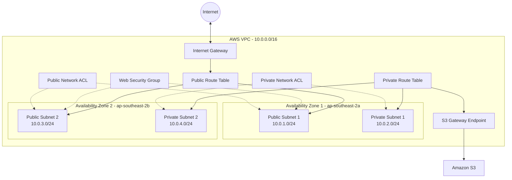

# AWS VPC Infrastructure Using Terraform

## Project Overview

This project focuses on designing and managing AWS network infrastructure using Terraform (Infrastructure as Code).

The architecture is designed across two Availability Zones in the Sydney region (ap-southeast-2), with separate public and private subnets, network security controls, routing and an S3 Gateway VPC Endpoint.

The primary goal is to build a structured, secure and scalable cloud networking environment while prioritising the AWS Free account plan.

## Architecture

The infrastructure consists of:

- 1 AWS VPC
- 2 Public Subnets
- 2 Private Subnets
- 2 Availability Zones
- 1 Internet Gateway
- Public and Private Route Tables
- Route Table Associations
- Web Security Group
- Custom Network ACLs
- S3 Gateway VPC Endpoint

## Architecture Diagram



The diagram represents the intended network architecture. It is not evidence of a deployed environment.

## AWS Services Used

| AWS Service | Purpose |
|---|---|
| Amazon VPC | Provides an isolated virtual network |
| Public Subnets | Designed for internet-facing resources |
| Private Subnets | Designed for internal resources |
| Internet Gateway | Enables internet connectivity for public subnet resources |
| Route Tables | Control network traffic routing |
| Security Groups | Control resource-level network traffic |
| Network ACLs | Control subnet-level network traffic |
| S3 Gateway Endpoint | Provides private connectivity to Amazon S3 |

## Terraform File Structure

| File | Purpose |
|---|---|
| provider.tf | AWS provider configuration |
| main.tf | VPC configuration |
| variables.tf | Input variables |
| subnets.tf | Public and private subnet configuration |
| network.tf | Internet Gateway and route tables |
| security.tf | Security Group configuration |
| nacl.tf | Custom Network ACL configuration |
| endpoint.tf | S3 Gateway Endpoint configuration |
| outputs.tf | Infrastructure outputs |
| .gitignore | Excludes unnecessary and sensitive files |

## Project Directory Structure

```text
terraform-project/
│
├── provider.tf
├── main.tf
├── variables.tf
├── subnets.tf
├── network.tf
├── security.tf
├── nacl.tf
├── endpoint.tf
├── outputs.tf
├── README.md
├── .gitignore
├── .terraform.lock.hcl
│
├── docs/
├── diagrams/
│   └── architecture.mmd
│
├── scripts/
│
└── reference/
    └── nat.tf
```

The NAT configuration in the reference directory is retained for documentation and is not part of the active Terraform configuration.

## Tools and Technologies

- Amazon Web Services (AWS)
- Terraform
- AWS CLI
- Ubuntu Linux
- Git
- GitHub

## Terraform Workflow

### 1. Initialize Terraform

```bash
terraform init
```

### 2. Format Terraform files

```bash
terraform fmt
```

### 3. Validate the configuration

```bash
terraform validate
```

### 4. Review the infrastructure plan

```bash
terraform plan
```

### 5. Deploy the infrastructure

Deployment must only be attempted after reviewing account permissions, Free plan eligibility and potential costs.

```bash
terraform apply
```

## Security Considerations

- Separate public and private subnet architecture.
- Security Group rules for HTTP and HTTPS traffic.
- Custom Network ACL rules for subnet-level traffic control.
- S3 Gateway Endpoint for private S3 connectivity.
- Terraform state and sensitive variable files excluded through .gitignore.

## Cost Considerations

This project prioritises the AWS Free account plan.

- No NAT Gateway is included in the active configuration.
- No EC2 instances or Load Balancers are included.
- Network ACLs have no additional charge.
- S3 Gateway Endpoints have no additional endpoint charge.
- S3 storage, requests and data transfer may have separate charges.

All services and deployment operations must be checked against the AWS account's actual service restrictions and applicable pricing before deployment.

## Project Status

Terraform configuration and planning are in progress.

The latest successful Terraform plan proposed:

- 26 resources to add
- 0 resources to change
- 0 resources to destroy

This represents a proposed infrastructure plan. Successful deployment has not yet been confirmed.

## Learning Objectives

- Understand AWS VPC networking.
- Design public and private subnet architecture.
- Configure Internet Gateways and route tables.
- Implement network security using Security Groups and Network ACLs.
- Configure S3 Gateway Endpoints.
- Automate infrastructure using Terraform.
- Manage infrastructure code using Git and GitHub.

## Future Improvements

- Improve Terraform code organisation.
- Add additional infrastructure validation.
- Improve network security rules.
- Add deployment and cleanup scripts.
- Document infrastructure testing and verification.

---

**Project:** AWS VPC Infrastructure Using Terraform

**Region:** Asia Pacific (Sydney) - ap-southeast-2

**Focus:** Cloud Networking | Infrastructure as Code | AWS | Terraform
